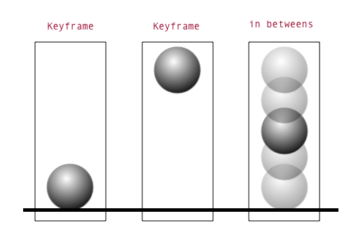
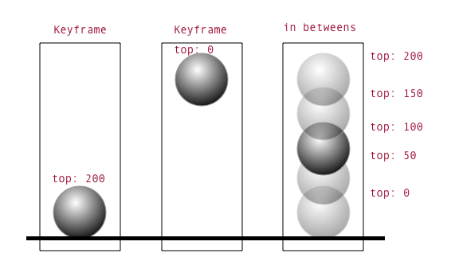

# Animation with @keyframes

A **transition** moves between two states when something changes, like on a hover. An **animation** plays a sequence you define with `@keyframes`, on its own: once, several times, or forever. Use it for loading indicators, attention-getters, and things that enter the page.

The rules from [UI States & Motion](ui-states.md) still apply: every animation needs a **job**, timing comes from **motion tokens**, and **reduced motion** gets a replacement.

## Today

| Time | What |
|:--|:--|
| 35 min | **Part 1: Concepts.** Read and try the examples |
| 10 min | Break |
| 80 min | **Part 2: In-class challenges** (self-paced) |
| 30 min | **Part 3: Homework.** Your Microinteractions looping animation |
| 10 min | Wrap up |

## Learning Objectives

1. Describe keyframes and in-betweens
2. Define an animation with `@keyframes` and apply it with `animation`
3. Control timing with duration, delay, iteration count, fill mode, and easing
4. Stagger several elements with one set of keyframes
5. Replace motion for `prefers-reduced-motion`, and let users pause looping motion

---

## Part 1: Concepts (35 min)

### See it first

Open both pages. They have the **same HTML**:

- [starter.html](animation-examples/starter.html): six components, nothing moves
- [finished.html](animation-examples/finished.html): all six animated

On the finished page: watch each animation, open the accordion, reload to replay the toast, and check **Pause all animations**. Then turn on reduced motion (DevTools → ⋮ → More tools → **Rendering** → "Emulate CSS media feature prefers-reduced-motion" → `reduce`) and see what changes.

> Clone or download the course repo to open these. GitHub shows the code, not the page.

### 1. Keyframes and in-betweens

In animation, **keyframes** are the important poses. For a bouncing ball, that's the top of the bounce and the bottom.



In CSS, keyframes are property values, like `translate: 0 -120px` and `translate: 0 0`.



The browser draws all the **in-betweens**. Between `-120px` and `0`, the ball passes through every value in between. The **easing** decides how those values are spread out over time: evenly (`linear`), bunched at the end (`ease-out`), or bunched at the start (`ease-in`).

### 2. Define the keyframes

```css
@keyframes drop {
  0%   { translate: 0 -120px; }   /* start of the animation */
  100% { translate: 0 0; }        /* end of the animation */
}
```

- Percentages are positions along the animation's **length**. The length itself is set later.
- `from` means `0%` and `to` means `100%`.
- Add as many steps as you need: `0%`, `40%`, `100%`. Steps that share values can share a line: `0%, 100% { opacity: 0.4; }`

### 3. Implicit keyframes

If a property **isn't** set at `0%` or `100%`, the browser uses the element's own value. This keeps keyframes short:

```css
@keyframes pulse {
  50% { scale: 1.25; }   /* 0% and 100% use the element's normal scale: 1 */
}

@keyframes spin {
  to { rotate: 1turn; }  /* no "from": it starts at the element's own rotation */
}
```

### 4. Apply the animation

```css
.badge {
  animation: pulse 600ms var(--ease-in-out) 3;
  /*         name  duration easing           how many times */
}
```

| Property | What it does | Example values |
|:--|:--|:--|
| `animation-name` | Which `@keyframes` to play | `pulse` |
| `animation-duration` | How long one cycle takes | `600ms`, `1.2s` |
| `animation-timing-function` | Easing | `var(--ease-out)`, `linear` |
| `animation-delay` | Wait before starting | `1s` |
| `animation-iteration-count` | How many cycles | `1`, `3`, `infinite` |
| `animation-direction` | Which way each cycle plays | `normal`, `alternate` |
| `animation-fill-mode` | Use the keyframe values before and after playing | `none`, `forwards`, `backwards`, `both` |
| `animation-play-state` | Pause it | `running`, `paused` |

You don't need to memorize these. Remember the ideas and look up the names.

### 5. Fill mode: before and after

Without a fill mode, an animation only affects the element **while it's playing**. Before a delay and after the last cycle, the element snaps back to its normal styles.

```css
.toast {
  animation: slide-up 400ms var(--ease-out) 1s both;
}
```

- `backwards`: during the 1s delay, show the **first** keyframe (hidden)
- `forwards`: after it ends, keep the **last** keyframe (visible)
- `both`: do both. It's usually what you want for one-time entrances.

### 6. Use `translate`, `rotate`, and `scale` separately

`translate`, `rotate`, and `scale` are separate properties. Each can be animated on its own without overwriting the others:

```css
/* ❌ transform is one property. Each keyframe must repeat every function. */
@keyframes old { 50% { transform: translateY(-1rem) rotate(10deg) scale(1.1); } }

/* ✅ Separate properties: set only what changes */
@keyframes new { 50% { translate: 0 -1rem; } }
```

They're still cheap to animate, just like `transform` and `opacity`.

### 7. Easing per keyframe

Set `animation-timing-function` **inside** a keyframe. It controls the motion from that keyframe to the next one:

```css
@keyframes bounce {
  0%   { translate: 0 -7.5rem; animation-timing-function: var(--ease-in); }   /* falling: speeds up */
  50%  { translate: 0 0;       animation-timing-function: var(--ease-out); }  /* rising: slows down */
  100% { translate: 0 -7.5rem; }
}
```

### 8. Stagger with a custom property

Several elements can share **one** set of keyframes. Give each element its own delay:

```html
<span style="--i: 0"></span>
<span style="--i: 1"></span>
<span style="--i: 2"></span>
```

```css
.dots span {
  animation: dot 1.2s var(--ease-in-out) infinite;
  animation-delay: calc(var(--i) * 160ms);
}
```

### 9. Transition or animation?

| Use a **transition** when... | Use an **animation** when... |
|:--|:--|
| A state changes: hover, focus, checked | Something plays on its own: loading, attention |
| There are two values: before and after | There are several steps |
| It should reverse when the state reverses | It should loop, or play once on load |

### 10. Reduced motion and pausing

Looping motion is the hardest kind of motion for people with vestibular disorders, and it's distracting for everyone. Two rules:

**Replace motion when users ask for less.** Keep the meaning, and remove the movement:

```css
@media (prefers-reduced-motion: reduce) {
  .spinner { animation: fade 1.5s var(--ease-in-out) infinite; }  /* fades instead of spinning */
  .badge   { animation: none; }                                    /* the red color is enough */
}
```

You can even redefine keyframes inside the media query. Then everything that uses them changes at once:

```css
@media (prefers-reduced-motion: reduce) {
  @keyframes slide-up { from { opacity: 0; } }   /* fade only, no slide */
}
```

**Let users stop looping motion.** If something moves for more than 5 seconds, users need a way to pause it (WCAG 2.2.2). One way to do it with CSS only:

```css
body:has(#pause:checked) * {
  animation-play-state: paused !important;
}
```

A loading spinner that disappears when loading finishes doesn't need a pause control. A decorative loop does.

---

## Part 2: In-class challenges (80 min)

**Goal:** animate the starter page, one component at a time. Each challenge ends with **Done when**.

**Try each one yourself first.** If you're stuck for 10 minutes, read the matching section of [finished.html](animation-examples/finished.html), close it, and write your own version.

### Setup (5 min)

1. Copy [starter.html](animation-examples/starter.html) into your `microinteractions` repo as `animation.html`.
2. Open it in your browser. Find the `YOUR ANIMATIONS GO HERE` comment at the bottom of the `<style>` tag. All your CSS goes there.

The motion tokens are already in `:root`.

**Done when:** `animation.html` is open in your browser.

### Challenge 1: Spinner (10 min)

Make `.spinner` rotate forever.

1. Write `@keyframes spin` that rotates to `1turn`.
2. Apply it to `.spinner`: about `800ms`, `linear`, `infinite`.

`linear` is right for a spinner: it should turn at a steady speed. It's one of the few times `linear` is a good choice.

**Done when:** the spinner turns smoothly, with no pause or jump at the end of each turn.

### Challenge 2: Loading dots (15 min)

Make the three dots pulse one after another.

1. Write `@keyframes dot`: small and faded (`scale: 0.6; opacity: 0.4`) at `0%, 80%, 100%`, full size at `40%`.
2. Apply it to `.dots span:not(.visually-hidden)` with `infinite`.
3. Stagger the dots with `animation-delay` and the `--i` custom property (concept 8).

**Done when:** the dots pulse in a wave, left to right, and all three use the **same** keyframes.

### Challenge 3: Toast (15 min)

Make the "Saved ✓" toast slide up and fade in **once**, 1 second after the page loads.

1. Write `@keyframes slide-up` from `opacity: 0; translate: 0 1rem` to `opacity: 1; translate: 0 0`.
2. Apply it with `var(--duration-slow)`, `var(--ease-out)`, and a `1s` delay.
3. Reload. The toast is visible during the delay, then jumps. Fix it with `animation-fill-mode` (concept 5).

**Done when:** after a reload, the toast is **invisible** for 1 second, slides in, and **stays**.

### Challenge 4: Badge (10 min)

Make the inbox badge pulse to get attention, then **stop**.

1. Write `@keyframes pulse` with only a `50%` step (concept 3).
2. Apply it so it plays **3 times**.

**Done when:** the badge pulses 3 times after a reload, then stays still. In a comment, name its job: attention.

### Challenge 5: Reduced motion and pause (20 min)

1. Turn on reduced-motion emulation.
2. Add a `@media (prefers-reduced-motion: reduce)` block:
   - **Spinner:** fade in and out instead of spinning
   - **Dots:** fade only, no scaling
   - **Badge:** no animation
   - **Toast:** fade only, no slide
3. Turn emulation off. Make the **Pause all animations** checkbox work with `:has()` and `animation-play-state` (concept 10).

**Done when:**

- [ ] With emulation on, nothing moves or changes size, but the spinner and dots still show that something is loading.
- [ ] Checking **Pause all animations** freezes everything, and unchecking it resumes everything.

### Stretch challenges

- **Accordion:** animate `details[open] .panel` so the content fades and slides down each time it opens. Why does it replay every time?
- **Bouncing ball:** use easing per keyframe (concept 7). Add a squash at the bottom with `scale: 1.15 0.85` and `transform-origin: bottom`.
- **Tune it:** change one duration at a time by 100ms. When does the spinner feel anxious? When do the dots feel sleepy?
- **Your own loop:** animate your logo or an icon from your Fix the AI Page. Give it a job, a reduced-motion version, and a pause.

---

## Part 3: Homework: Microinteractions (30 min in class)

Today's work is **element 3, the looping animation**, of the [Microinteractions homework](ui-states.md#part-3-homework-microinteractions). It's due **Thursday, Nov 19**.

Use the rest of class to choose and start your looping animation:

1. Pick one: a loading indicator, a pulsing notification, or an animated logo. It should be **your own design**, not a copy of today's examples.
2. Add a **state matrix** for it to `DESIGN-LOG.md`. For an animation, list the keyframes instead of states: what it looks like at each step.
3. Name its **job** in a CSS comment.
4. Build it with your motion tokens.
5. Add its **reduced-motion** replacement.
6. If it loops for more than 5 seconds, add a **pause** control.

**Done when:** your looping animation plays, has a reduced-motion version, and is committed to your `microinteractions` repo.

---

## Study real animations

Pick two and answer: **which properties change?** Translate, rotate, scale, opacity, color? What's the job of each animation?

- https://codepen.io/FabioG/full/QjLreK
- https://codepen.io/t_afif/pen/PoJavbw
- https://codepen.io/donovanh/full/pvMeeB
- https://codepen.io/yoannhel/full/sJpDj
- https://codepen.io/Manoz/full/pydxK
- https://codepen.io/Venerons/full/BvHbK
- https://codepen.io/MarioDesigns/full/woJgeo
- https://codepen.io/u1tralord/full/pvXwza
- https://codepen.io/antho-fsy/pen/wJqWKj

More examples to download: [animation-examples repo](https://github.com/Tech-at-DU/animation-examples)

## Resources

- [MDN: Using CSS animations](https://developer.mozilla.org/en-US/docs/Web/CSS/CSS_Animations/Using_CSS_animations)
- [MDN: animation](https://developer.mozilla.org/en-US/docs/Web/CSS/animation)
- [MDN: prefers-reduced-motion](https://developer.mozilla.org/en-US/docs/Web/CSS/@media/prefers-reduced-motion)
- [WCAG 2.2.2: Pause, Stop, Hide](https://www.w3.org/WAI/WCAG22/Understanding/pause-stop-hide.html)
- [thoughtbot: CSS animation for beginners](https://thoughtbot.com/blog/css-animation-for-beginners)
- [cubic-bezier.com](https://cubic-bezier.com) for designing easing curves
